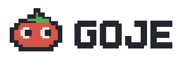

# goje

Goje is a Go game framework and toolchain for desktop and web. It supports 2D and aims to make 2.5D action and RTS-style games especially practical. Goje (/ɡoʊˈdʒe/, roughly “go-JEH”) means “tomato” in Persian (گوجه).

The reference [playground](docs/playground.md) runs an isometric courtyard on desktop and web. Build maps and [author sight](docs/levels.md#set-what-units-can-see) in the Level Builder. The other browser tools edit [tiles](docs/playground.md#draw-a-ground-tile-in-the-browser), [sprite art](docs/playground.md#draw-pixel-art-in-the-browser), [sprite clips](docs/playground.md#author-sprite-clips-in-the-browser), [sounds and music](docs/audio.md), and [bitmap fonts](docs/text-and-ui.md#make-your-own-font).

The [outpost](docs/playground.md#the-outpost) is a real-time battle with group orders, fog of war, positional sound, touch and gamepad input, and [saved games and replays](docs/replays.md). Play [co-op or versus](docs/playground.md#play-the-outpost-online) across desktop and web, [watch a live match](docs/playground.md#watch-live-or-rejoin), or replay the last online match offline. See [building and packaging](docs/building.md) to ship a game.

The [Beacon challenge](specs/beacon-m18.md) is a small standalone game with keyboard and touch controls. Run it with `go run ./examples/beacon`, or [package it](docs/building.md#package) for native desktop and the web.

- [Contributing](CONTRIBUTING.md)
- [Security policy](SECURITY.md)
- [Code of conduct](CODE_OF_CONDUCTS.md)
- [Agent instructions](AGENTS.md) and [workspace map](.ai/README.md)
